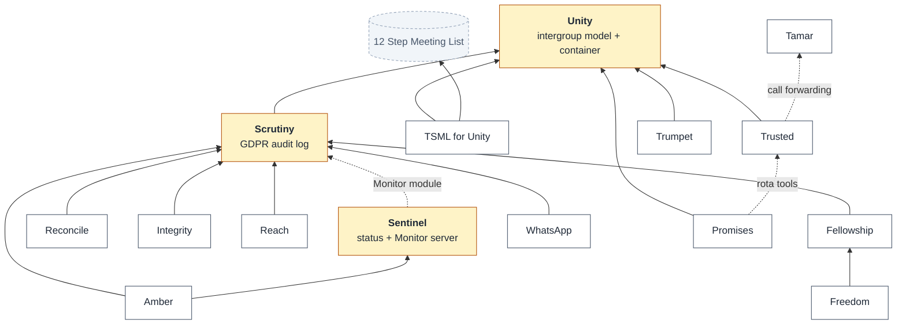
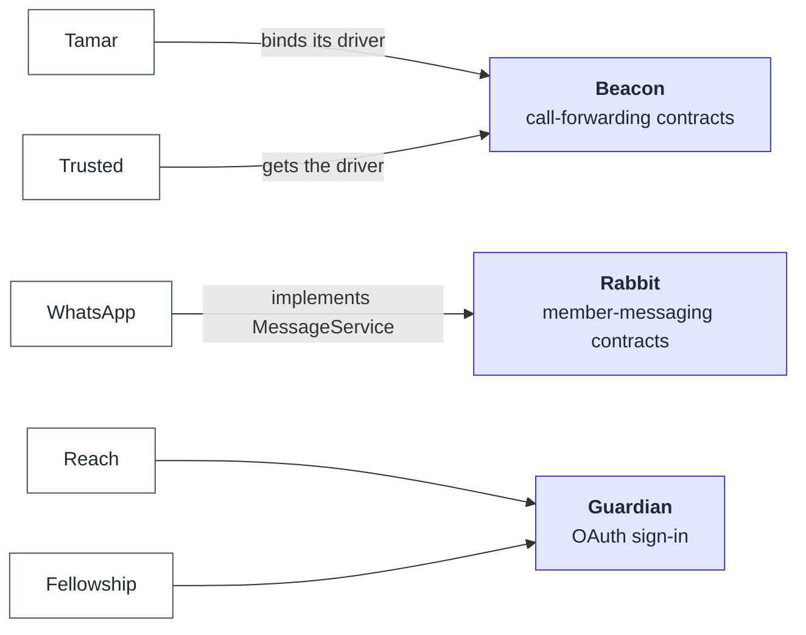
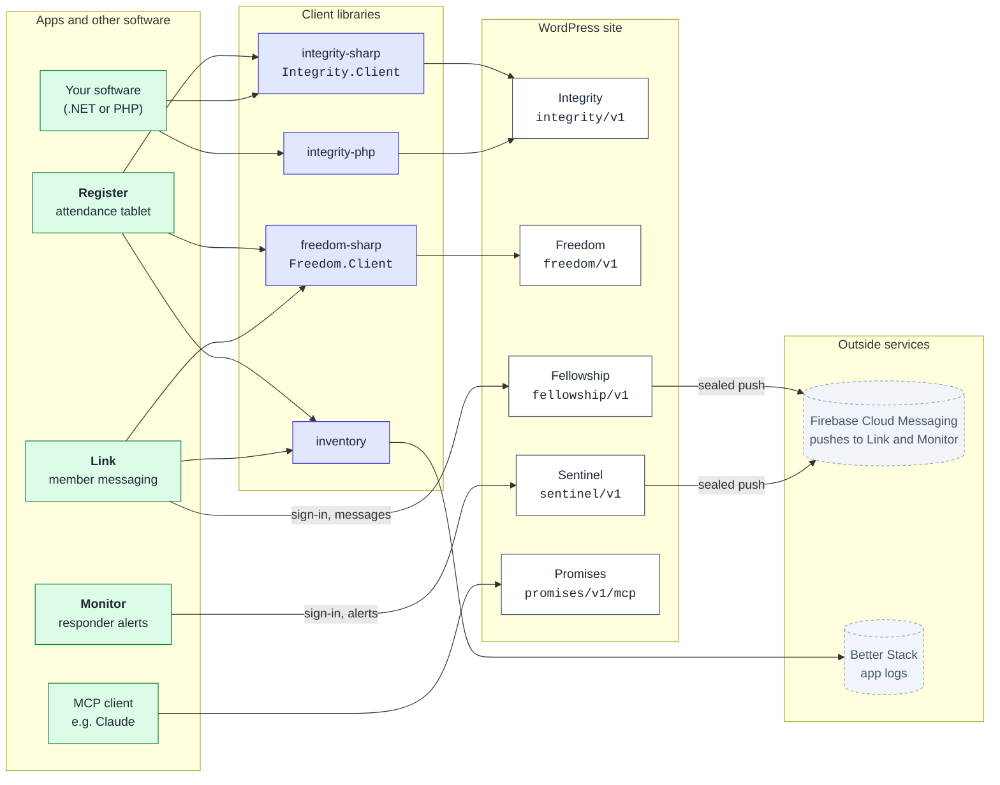
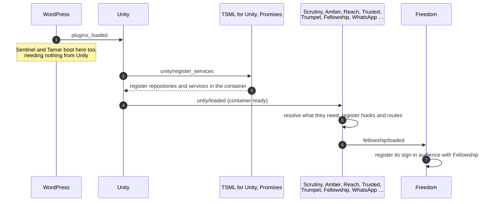
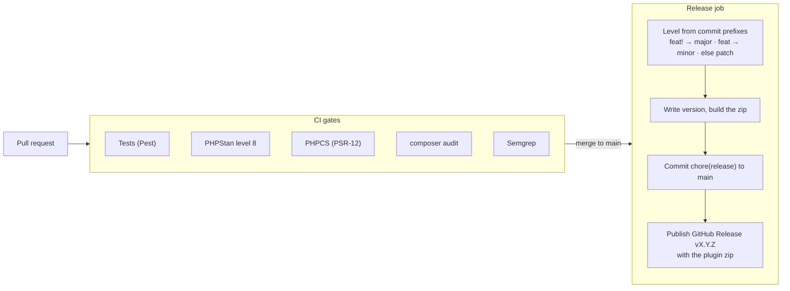

# The Bleeding Deacons

Open-source tools for running an **AA intergroup**: the groups and meetings it
lists, the members who serve, the telephone responders who answer its helpline,
and the people who need to reach them.

Most of it is a suite of **WordPress plugins** built around one core,
**Unity**, which models the intergroup. Around the plugins sit a handful of
**Composer libraries** they share, **.NET MAUI apps** for the handsets and
tablets that use the site, and **REST clients** for anything else that wants to
talk to it.

Everything here is MIT (Modified — no resale) unless its repository says
otherwise. Looking for one repository? See the
[index of every repository](#every-repository) at the end.

---

## At a glance

| Layer | What it is | Repositories |
| --- | --- | --- |
| **Core** | The intergroup model, audit log and status dashboard every other plugin builds on | [unity](https://github.com/bleedingdeacons/unity) · [scrutiny](https://github.com/bleedingdeacons/scrutiny) · [sentinel](https://github.com/bleedingdeacons/sentinel) |
| **Data & admin** | Where the data comes from, how it is edited and how it is moved in bulk | [tsml-for-unity](https://github.com/bleedingdeacons/tsml-for-unity) · [amber](https://github.com/bleedingdeacons/amber) · [reconcile](https://github.com/bleedingdeacons/reconcile) · [trumpet](https://github.com/bleedingdeacons/trumpet) |
| **Helpline** | The telephone rota, call forwarding and finding a 12th-step volunteer | [trusted](https://github.com/bleedingdeacons/trusted) · [tamar](https://github.com/bleedingdeacons/tamar) · [reach](https://github.com/bleedingdeacons/reach) |
| **Messaging & apps** | Server sides for the apps, and outbound messaging | [fellowship](https://github.com/bleedingdeacons/fellowship) · [freedom](https://github.com/bleedingdeacons/freedom) · [whatsapp](https://github.com/bleedingdeacons/whatsapp) |
| **APIs** | The intergroup's data, published to other software | [integrity](https://github.com/bleedingdeacons/integrity) · [promises](https://github.com/bleedingdeacons/promises) |
| **Standalone** | Plugins that need nothing else from the suite | [concordance](https://github.com/bleedingdeacons/concordance) · [confur](https://github.com/bleedingdeacons/confur) · [lifelines](https://github.com/bleedingdeacons/lifelines) |
| **Libraries** | Shared code bundled into plugins through Composer — never activated | [beacon](https://github.com/bleedingdeacons/beacon) · [rabbit](https://github.com/bleedingdeacons/rabbit) · [guardian](https://github.com/bleedingdeacons/guardian) · [wp-mocks](https://github.com/bleedingdeacons/wp-mocks) |
| **Apps** | .NET MAUI apps for tablets and phones | [register](https://github.com/bleedingdeacons/register) · [link](https://github.com/bleedingdeacons/link) · [monitor](https://github.com/bleedingdeacons/monitor) |
| **Clients** | Libraries an app uses to reach the site | [integrity-sharp](https://github.com/bleedingdeacons/integrity-sharp) · [integrity-php](https://github.com/bleedingdeacons/integrity-php) · [freedom-sharp](https://github.com/bleedingdeacons/freedom-sharp) · [inventory](https://github.com/bleedingdeacons/inventory) |

---

## How the plugins depend on each other

An arrow points at what a plugin needs. Solid lines are hard requirements;
dotted ones are optional.



Everything that needs Scrutiny also needs Unity. Unity ships **headless**: it
defines the interfaces and the container, and TSML for Unity supplies the
concrete repositories, backed by the
[12 Step Meeting List](https://github.com/bleedingdeacons/12-step-meeting-list)
plugin's meetings and groups.

**Standalone**, with no Unity dependency: Concordance (a client for the AAGBDB
Groups API), Confur (needs 12 Step Meeting List and ACF) and LifeLines (needs
nothing). **Tamar** is standalone too — Trusted uses it when it is there.

---

## The plugins

### Core

| Plugin | What it does |
| --- | --- |
| [**Unity**](https://github.com/bleedingdeacons/unity) | The intergroup model — groups, meetings, members, service positions, locations, contacts and intergroup meetings — as interfaces, plus the dependency-injection container, caching, configuration and change tracking the rest of the suite registers against. Fires `unity/loaded`, which almost everything else waits for. |
| [**Scrutiny**](https://github.com/bleedingdeacons/scrutiny) | GDPR audit logging and personal-data masking. Records who saw or changed personal data and when, and hides it in the admin from anyone without clearance. |
| [**Sentinel**](https://github.com/bleedingdeacons/sentinel) | A dashboard of which suite plugins are installed, active and at what version, and the shared logger. Also hosts **Monitor**'s server (`sentinel/v1`): handset sign-in, sealed push alerts and paging admins when a matching error is logged. |

### Data and administration

| Plugin | What it does |
| --- | --- |
| [**TSML for Unity**](https://github.com/bleedingdeacons/tsml-for-unity) | Implements every Unity interface over 12 Step Meeting List data, so the meeting list a site already has becomes Unity's groups and meetings. |
| [**Amber**](https://github.com/bleedingdeacons/amber) | The admin interface: the *Intergroup* menu, dashboard widgets for positions, meetings and attendance, position shortcodes and data validation. |
| [**Reconcile**](https://github.com/bleedingdeacons/reconcile) | Spreadsheet import and export (`.xlsx`, `.xls`, `.csv`) for members, groups and positions. |
| [**Trumpet**](https://github.com/bleedingdeacons/trumpet) | Announcements, and a `[todays_meetings]` shortcode for the front page. |

### Helpline

| Plugin | What it does |
| --- | --- |
| [**Trusted**](https://github.com/bleedingdeacons/trusted) | A seven-day telephone-responder rota: weekly shift templates, applied to a week and filled from a calendar view with Unity's telephone responders. |
| [**Tamar**](https://github.com/bleedingdeacons/tamar) | Call forwarding through Tamar Telecommunications' control panel — reads and writes the hunt group, so the helpline rings whoever is on shift. Implements Beacon's contract. |
| [**Reach**](https://github.com/bleedingdeacons/reach) | The public 12th-step finder: sign in with Google, Microsoft, Apple or Facebook, enter an area, see the nearest available 12th-step volunteers. Every member shown is audit-logged against the visitor's verified email. |

### Messaging and the apps' servers

| Plugin | What it does |
| --- | --- |
| [**Fellowship**](https://github.com/bleedingdeacons/fellowship) | The server side of **Link**. Enrols handsets against Unity members by OAuth-verified email, stores messages and delivers them to members and committees as push notifications sealed to each handset's own key. Also signs other plugins' users in through Google. |
| [**Freedom**](https://github.com/bleedingdeacons/freedom) | Zero-configuration settings for the apps. A tablet signs in through Fellowship and receives its application's configuration — versioned per key, with secrets sealed to that tablet. This is how **Register** gets its credentials without any being built into it. |
| [**WhatsApp**](https://github.com/bleedingdeacons/whatsapp) | Sends WhatsApp messages to Unity members through Meta's WhatsApp Business Cloud API, audit-logged through Scrutiny. Implements Rabbit's contract. |

### Published APIs

| Plugin | What it does |
| --- | --- |
| [**Integrity**](https://github.com/bleedingdeacons/integrity) | A secure REST API (`integrity/v1`) over Unity's groups, meetings, members, positions and intergroup meetings. Argon2id-hashed API keys scoped per resource, rate limiting, IP allow-lists, HTTPS enforcement and a full request log. |
| [**Promises**](https://github.com/bleedingdeacons/promises) | A [Model Context Protocol](https://modelcontextprotocol.io) server (`promises/v1/mcp`), so an AI assistant can read the intergroup's records — and, if an admin allows it, fill gaps in the Trusted rota. Personal contact details are masked by default. |

### Standalone

| Plugin | What it does |
| --- | --- |
| [**Concordance**](https://github.com/bleedingdeacons/concordance) | A client for the [AAGBDB](https://aagbdb.org.uk) Groups API: a caching REST proxy, a dashboard widget and WP-CLI commands. GPL v2. |
| [**Confur**](https://github.com/bleedingdeacons/confur) | Collates groups' answers to Conference questions — a public form for groups, and status and results screens for the region's representatives. |
| [**LifeLines**](https://github.com/bleedingdeacons/lifelines) | A fast public lookup over a UK place, service and helpline dataset uploaded as CSV. |

---

## Shared libraries

These are **Composer packages, not plugins** — they are never activated. Each
consuming plugin ships its own copy in `vendor/`. A PHP class loads once per
request, so whichever copy loads first serves every plugin that uses it, and
consumers move to a new major version together.



| Library | What it provides |
| --- | --- |
| [**Beacon**](https://github.com/bleedingdeacons/beacon) | The `CallForwardingService` contract, models, HTTP transport, the `beacon_*` roles, an optional `beacon/v1` REST API, and `ForwardingRegistry` — where Tamar publishes its driver and Trusted finds it, whichever loads first. |
| [**Rabbit**](https://github.com/bleedingdeacons/rabbit) | The `MessageService` contract, message models and `MemberMessenger`: member → message → driver, with a Scrutiny audit entry. WhatsApp registers it into Unity's container, and any plugin can resolve it from there. |
| [**Guardian**](https://github.com/bleedingdeacons/guardian) | Google, Microsoft, Facebook and Apple sign-in, RS256 ID-token verification with cached key sets, single-use sign-in state, and the provider-credentials settings section. Who may sign in, and what that becomes, stays with each plugin. |
| [**wp-mocks**](https://github.com/bleedingdeacons/wp-mocks) | Development only: the suite's WordPress test doubles — a state-backed stub layer over Brain Monkey, plus fakes for `$wpdb` and the WP HTTP API. |

Install one through a `vcs` repository:

```json
"repositories": [{ "type": "vcs", "url": "https://github.com/bleedingdeacons/beacon" }],
"require": { "bleedingdeacons/beacon": "^1.0" }
```

---

## Apps and REST clients

Three .NET MAUI apps use the site, each through the plugin that is its server
side. External software uses Integrity's API through one of its clients, and AI
assistants use Promises.



### Apps

| App | Platforms | What it does | Server side |
| --- | --- | --- | --- |
| [**Register**](https://github.com/bleedingdeacons/register) | Android tablet | The intergroup meeting's attendance register: keeps a local SQLite copy of Unity's data, records attendance and consent, and sends welcome and acceptance emails. Every credential it uses arrives from Freedom — none is built in. | Integrity · Freedom |
| [**Link**](https://github.com/bleedingdeacons/link) | Android (iOS in progress) | Messaging between members and to committees. Recipients are picked from an anonymous directory, never typed; each push is sealed to a key only that handset holds. | Fellowship |
| [**Monitor**](https://github.com/bleedingdeacons/monitor) | Android, iOS, Mac Catalyst, Windows | Rings telephone responders — loudly, repeatedly, over the lock screen — until somebody acknowledges, and pages admins who opt in to site errors. Every alert is stored before it is pushed, and handsets poll as well, so nothing depends on push alone. Formerly *Hand*, served by Reach. | Sentinel |

### Client libraries

| Library | Language | What it does |
| --- | --- | --- |
| [**integrity-sharp**](https://github.com/bleedingdeacons/integrity-sharp) | C# / .NET 9 | Typed client for Integrity's API. Published to GitHub Packages as **`Integrity.Client`**, with its models bundled. |
| [**integrity-php**](https://github.com/bleedingdeacons/integrity-php) | PHP 8.1 | A single-file cURL client for Integrity's API, with typed response objects and rate-limit details. |
| [**freedom-sharp**](https://github.com/bleedingdeacons/freedom-sharp) | C# / .NET MAUI | The app half of Freedom: sign in once, then on each start fetch only the settings whose version changed (usually a `304`), and open secrets with the device's own key. **`Freedom.Client`** and **`Freedom.Client.Maui`**. |
| [**inventory**](https://github.com/bleedingdeacons/inventory) | C# / .NET MAUI | Durable logging to Better Stack for apps that spend their lives without signal: disk first, each event's own timestamp, errors flushed at once, and a pipeline that can be pointed somewhere new after sign-in without losing anything. |

The .NET packages are on GitHub Packages, which asks for a token even for public
packages — a classic personal access token with only `read:packages` is enough:

```xml
<packageSources>
  <add key="bleedingdeacons" value="https://nuget.pkg.github.com/bleedingdeacons/index.json" />
</packageSources>
```

---

## How a request boots the suite

The plugins do not depend on WordPress's load order. Each one waits for the
action fired by the plugin it needs, so a missing dependency means a plugin
quietly stands down rather than failing.



Most plugins also define a `<PLUGIN>_KILL` constant — set it in
`wp-config.php` to stand a plugin down without deactivating it.

---

## How changes ship

Every maintained plugin releases itself when a pull request merges to `main`.



So a PR title is a release note: **`feat:`** cuts a minor version, **`fix:`**
and everything else a patch, and **`feat!:`** or `BREAKING CHANGE` a major.
Pull requests are squash-merged, so the PR title is what the release job reads.

The Composer libraries are released by hand as `vX.Y.Z` tags; the .NET
libraries publish to GitHub Packages from a tag.

---

## Every repository

| Repository | Kind | Language | Purpose |
| --- | --- | --- | --- |
| [amber](https://github.com/bleedingdeacons/amber) | Plugin | PHP | The admin interface for Unity: the *Intergroup* menu, dashboard widgets for positions, meetings and attendance, and position shortcodes. |
| [beacon](https://github.com/bleedingdeacons/beacon) | Library | PHP | Call-forwarding contracts, roles and an optional REST API, plus the registry where a driver (Tamar) is published and a consumer (Trusted) finds it. |
| [concordance](https://github.com/bleedingdeacons/concordance) | Plugin | PHP | Client for the AAGBDB Groups API: a caching REST proxy, a dashboard widget and WP-CLI commands. Standalone; GPL v2. |
| [confur](https://github.com/bleedingdeacons/confur) | Plugin | PHP | Collates groups' answers to Conference questions: a public form for groups, status and results screens for region representatives. Standalone. |
| [fellowship](https://github.com/bleedingdeacons/fellowship) | Plugin | PHP | Server side of Link: enrols handsets against Unity members, stores messages and pushes them sealed to each handset's key. Also signs in for Freedom. |
| [freedom](https://github.com/bleedingdeacons/freedom) | Plugin | PHP | Zero-configuration settings for the apps: a tablet signs in through Fellowship and receives versioned configuration, with secrets sealed to that tablet. |
| [freedom-sharp](https://github.com/bleedingdeacons/freedom-sharp) | Client | C# | The app half of Freedom (`Freedom.Client`, `Freedom.Client.Maui`): sign in once, fetch only changed settings on each start, open secrets with the device key. |
| [guardian](https://github.com/bleedingdeacons/guardian) | Library | PHP | OAuth sign-in shared by Reach and Fellowship: Google, Microsoft, Facebook and Apple providers, ID-token verification and single-use sign-in state. |
| [integrity](https://github.com/bleedingdeacons/integrity) | Plugin | PHP | A secure REST API over Unity's groups, meetings, members and positions: scoped API keys, rate limits, IP allow-lists and a full request log. |
| [integrity-php](https://github.com/bleedingdeacons/integrity-php) | Client | PHP | A single-file cURL client for Integrity's API, with typed responses. |
| [integrity-sharp](https://github.com/bleedingdeacons/integrity-sharp) | Client | C# | A typed .NET client for Integrity's API, published as `Integrity.Client`. Used by Register. |
| [inventory](https://github.com/bleedingdeacons/inventory) | Client | C# | Durable Better Stack logging for .NET apps: buffered to disk, timestamped at source, shipped once the app knows where. Used by Register and Link. |
| [lifelines](https://github.com/bleedingdeacons/lifelines) | Plugin | PHP | A fast public lookup over a UK place, service and helpline dataset uploaded as CSV. Standalone. |
| [link](https://github.com/bleedingdeacons/link) | App | C# | Messaging between members and to committees, from a phone. Server side is Fellowship. |
| [monitor](https://github.com/bleedingdeacons/monitor) | App | C# | Rings telephone responders until an alert is acknowledged, and pages admins about site errors. Server side is Sentinel. |
| [promises](https://github.com/bleedingdeacons/promises) | Plugin | PHP | A Model Context Protocol server, so an AI assistant can read the intergroup's records and, if allowed, fill gaps in the rota. |
| [rabbit](https://github.com/bleedingdeacons/rabbit) | Library | PHP | Member-messaging contracts and `MemberMessenger`, which sends to a Unity member through whichever driver is registered and audits it. |
| [reach](https://github.com/bleedingdeacons/reach) | Plugin | PHP | The public 12th-step finder: sign in, enter an area, see the nearest available 12th-step volunteers. |
| [reconcile](https://github.com/bleedingdeacons/reconcile) | Plugin | PHP | Spreadsheet import and export for members, groups and positions. |
| [register](https://github.com/bleedingdeacons/register) | App | C# | The intergroup meeting's attendance register on an Android tablet, working from a local copy of Unity's data. Server side is Integrity and Freedom. |
| [scrutiny](https://github.com/bleedingdeacons/scrutiny) | Plugin | PHP | GDPR audit logging of who saw or changed personal data, and masking it from anyone without clearance. |
| [sentinel](https://github.com/bleedingdeacons/sentinel) | Plugin | PHP | A dashboard of the suite's plugins and versions, the shared logger, and Monitor's server side. |
| [tamar](https://github.com/bleedingdeacons/tamar) | Plugin | PHP | Call forwarding through Tamar Telecommunications' control panel, so the helpline rings whoever is on shift. |
| [trumpet](https://github.com/bleedingdeacons/trumpet) | Plugin | PHP | Announcements, and a shortcode listing today's meetings on the front page. |
| [trusted](https://github.com/bleedingdeacons/trusted) | Plugin | PHP | The seven-day telephone-responder rota: weekly templates applied to a week and filled from a calendar. |
| [tsml-for-unity](https://github.com/bleedingdeacons/tsml-for-unity) | Plugin | PHP | Implements Unity's model over 12 Step Meeting List data, so an existing meeting list becomes Unity's groups and meetings. |
| [unity](https://github.com/bleedingdeacons/unity) | Plugin | PHP | The core: the intergroup model as interfaces, and the container every other plugin registers against. |
| [whatsapp](https://github.com/bleedingdeacons/whatsapp) | Plugin | PHP | Sends WhatsApp messages to Unity members through Meta's Business Cloud API. |
| [wp-mocks](https://github.com/bleedingdeacons/wp-mocks) | Library | PHP | Development only: the suite's shared WordPress test doubles over Brain Monkey. |

---

## Requirements

- **WordPress** 6.0 or later (6.1 for about half the plugins)
- **PHP** 8.4 or later for every plugin; integrity-php runs on 8.1
- **.NET** 10 for the apps; `Integrity.Client` targets .NET 9

---

## Contact

[thebleedingdeacons@gmail.com](mailto:thebleedingdeacons@gmail.com)
